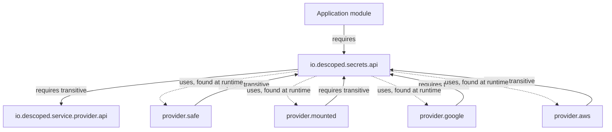
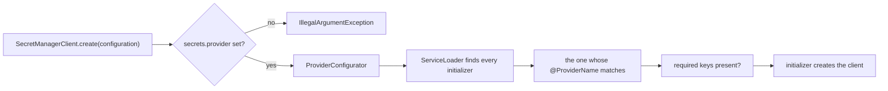
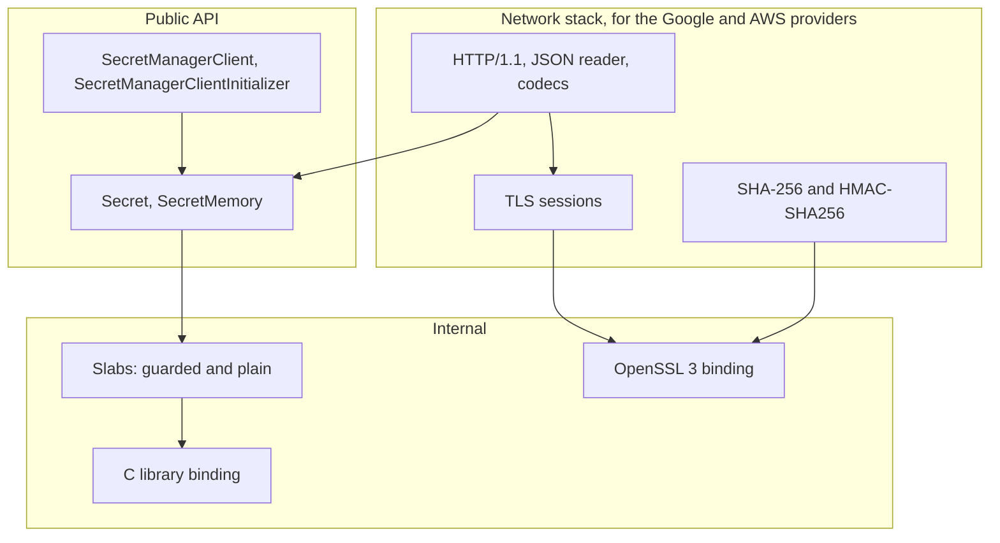
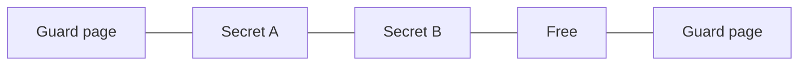
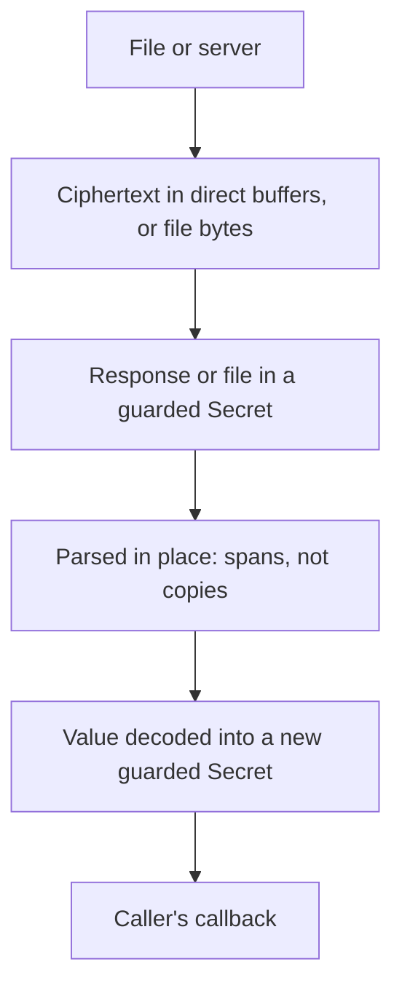

# Architecture

The secrets client is one Maven reactor of named Java modules. Applications compile against one module, the API.
Providers are separate modules that the API finds at runtime. Everything that touches a secret value, from the file
or the network to the caller, works on guarded native memory that the API module owns.

## Modules

Module | JPMS module | Role
---|---|---
`secrets-client-api` | `io.descoped.secrets.api` | `SecretManagerClient`, `Secret`, `SecretMemory`, the provider service, and the network stack the network providers share
`secrets-provider-safe-configuration` | `io.descoped.secrets.provider.safe` | a local `key=value` file, for development and tests
`secrets-provider-mounted` | `io.descoped.secrets.provider.mounted` | read-only: files the platform mounts
`secrets-provider-google-secret-manager` | `io.descoped.secrets.provider.google` | Google Secret Manager over its REST API
`secrets-provider-aws-secrets-manager` | `io.descoped.secrets.provider.aws` | AWS Secrets Manager over its JSON API, signed with SigV4
`secrets-client-bom` | n/a | the BOM of the modules above

The API module has one dependency, `io.descoped.service.provider.api`, and requires it transitively. Each provider
requires the API module transitively and nothing else. No module depends on a third-party library.

The application requires only the API module. The provider modules are not required by anyone: they are resolved
because the API module declares `uses` for the provider service.

### What the API module exports

Package | Exported to | Contents
---|---|---
`io.descoped.secrets.api` | everyone | `SecretManagerClient`, `SecretManagerClientInitializer`, `Secret`, `SecretMemory`, the exceptions
`io.descoped.secrets.api.tls` | the Google and AWS providers, and the API module's tests | `TlsContext`, `TlsSession`: TLS through OpenSSL
`io.descoped.secrets.api.http` | the Google and AWS providers only | `Http`, `Json`, `Codec`: HTTP/1.1, a JSON reader, encodings
`io.descoped.secrets.api.crypto` | the AWS provider, and the tests of the API module and of the test support | `Sha256`: SHA-256 and HMAC-SHA256 through OpenSSL
`io.descoped.secrets.api.internal` | nobody | the slabs, and the bindings to the C library and to OpenSSL

The three network packages are qualified exports. They are plumbing for the providers, not API: an application
module cannot read them. The safe-configuration and mounted providers need none of them.

## The provider service

A provider is a `SecretManagerClientInitializer`, the service interface of the API module. It extends
`ProviderInitializer<SecretManagerClient>` from service-provider-api and carries the provider's name in a
`@ProviderName` annotation. It declares the configuration keys it requires and creates a client from the
configuration map.

`SecretManagerClient.create` reads `secrets.provider` and hands the whole map to service-provider-api's
`ProviderConfigurator`. It finds the initializers with `ServiceLoader`, picks the one with that name, checks the keys
the initializer requires, and calls it. No provider, or more than one, with that name is a `ProviderException`.

Each provider registers its initializer twice:

- with `provides` in its `module-info.java`, for the module path;
- in `META-INF/services/io.descoped.secrets.api.SecretManagerClientInitializer`, for the class path.

In every provider module only the initializer is public. The client and its helpers are package-private, so an
application reaches a provider only through `SecretManagerClient`. [Writing a provider](writing-a-provider.md)
shows the same pattern for a backend of your own.

## Layers of the API module

### Clients and secrets

`SecretManagerClient` is the interface every provider implements, with one contract
([the contract](api.md#the-contract)). Values pass through it only as a `Secret`, a value in a `SecretMemory`.
How an application uses them is described in [guarded memory](api.md#guarded-memory-secretmemory-and-secret).

### Guarded memory

A `SecretMemory` is a pool of slabs. A `Secret` is a block in one slab. The pool takes a block from the first slab
that has a free range large enough, and maps a new slab when none has. Blocks start at multiples of 16 bytes. A
secret that fits in no slab gets a new slab of whole pages sized for it. When a block is freed it is wiped, its
range is merged with free neighbours, and a slab that becomes empty is unmapped, unless it is the pool's only slab.
The first slab is mapped when the memory is created, so a missing permission or locked-memory limit is reported at once.

A guarded slab is one mapping: a guard page, the data pages, a guard page. The guard pages are never
accessible. The data pages become accessible only while a secret on them is read, written or wiped; otherwise
they are `PROT_NONE`. Secrets in the same slab are not separated by guard pages. The data pages are locked, and on
Linux kept out of core dumps and taken from `memfd_secret` where the kernel offers it.
[Guarded memory](api.md#guarded-memory-secretmemory-and-secret) lists each protection and the configuration that
controls it.

With `secrets.memory.guard=off` the pool uses plain slabs instead: off-heap memory from the JVM, wiped when freed,
without guard pages, locking, access control or native access. It is meant for tests.

Reading a file or channel into a `Secret` (`SecretMemory.read`) goes straight into a block. When the slabs come from
`memfd_secret`, whose pages the kernel cannot pin, the read goes through a small bounce buffer instead: one block in
a pool of its own on ordinary guarded, locked pages, wiped and unmapped before the read returns.

### Network stack

The Google and AWS providers talk to their services through a small stack in the API module rather than through the
JDK's `SSLEngine`, an HTTP client library or a JSON library, all of which copy data through the Java heap.

- **HTTP/1.1** (`Http`): a request is built in a `Secret`, from fixed text and header values that may themselves be
  in guarded memory (`SecretHeader`, such as an access token). The response body is read into a `Secret`. Each
  request has a connection of its own, closed after the response. Bodies are framed by `Content-Length` or chunked
  encoding, and every wait has a deadline from the connect and request timeouts.
- **Connections**: a non-blocking socket, plain for an http endpoint (the metadata and credential endpoints of the
  platform, loopback test servers), TLS for https. Waiting for data is separate from reading it, so guarded memory
  is opened only to move bytes that have already arrived.
- **JSON** (`Json`): a reader that copies nothing. Strings and numbers are spans of the segment that holds the
  response, so a value in a string is decoded from there straight into another `Secret`. Only object keys become
  `String`s.
- **Codecs** (`Codec`): Base64, JSON string escapes, form encoding and CRC32C, from native memory to native memory.
- **TLS** (`TlsContext`, `TlsSession`): a client of the system's OpenSSL 3 on memory buffers. Plaintext goes
  directly between the caller's guarded buffer and OpenSSL; the connection's own buffers hold only ciphertext. The
  context sets the protocol versions, ciphers, trust and host name checks; the
  [provider pages](providers/google-secret-manager.md#memory-and-tls) describe them.
- **Crypto** (`Sha256`): SHA-256 and HMAC-SHA256 through OpenSSL's `libcrypto`, reading keys and messages where they
  are. The AWS provider signs requests with it.

### Native bindings

The internal package calls native code through the Foreign Function & Memory API; there is no JNI and no bundled
native library.

- `Native` binds the C library calls guarded memory needs: `mmap`, `mprotect`, `mlock`, `munlock`, `munmap`,
  `madvise`, `getpagesize`, and on Linux `ftruncate`, `close` and `syscall` for the `memfd_secret` and `getrandom`
  system calls. It supports Linux and macOS on x86_64 and aarch64, and captures `errno` on every call that can
  fail.
- `OpenSsl` binds the system's `libssl` and `libcrypto` (version 3 or later), loaded once on first use. It is loaded
  only by a client that needs TLS or signing.

These calls are why the JVM must grant native access to `io.descoped.secrets.api`
([getting started](getting-started.md)).

## What each provider contains

Provider | Classes and their roles
---|---
safe-configuration | `SafeConfigurationClientInitializer` (configuration); `SafeConfigurationClient` (holds each value in a `Secret`); `SecretsFile` (reads, parses and rewrites the file in guarded memory)
mounted | `MountedClientInitializer` (configuration); `MountedClient` (checks the name, resolves the file inside the directory and reads it on every `read`)
google-secret-manager | `GoogleSecretManagerClientInitializer` (configuration, TLS context, token source); `GoogleSecretManagerClient` (the REST calls); `AccessTokens` (the current access token, from the metadata server or an `authorized_user` file)
aws-secrets-manager | `AwsSecretsManagerClientInitializer` (configuration); `AwsSecretsManagerClient` (the JSON API calls); `SigV4` (request signing); `CredentialSources` (which source to use); `CredentialsProvider` (the current credentials, refreshed before they expire); `SharedCredentialsFile`, `ContainerCredentials`, `InstanceMetadataCredentials`, `EnvironmentCredentials` (the sources); `CredentialsDocument` (parses a credentials response); `Credentials` (the key ID, secret key and session token)

Each client owns one `SecretMemory`, created from the same configuration map, and the Google and AWS clients own one
`TlsContext` when they reach anything over https. Closing the client closes them. The provider pages describe each
provider's configuration and behaviour: [safe-configuration](providers/safe-configuration.md),
[mounted](providers/mounted.md), [google-secret-manager](providers/google-secret-manager.md) and
[aws-secrets-manager](providers/aws-secrets-manager.md).

## Where secrets live

Layer | What holds a secret
---|---
Application | a `Secret` handle; the value itself only inside a callback (a heap copy from `withBytes` or `withChars`, wiped when it returns, or the guarded memory itself from `withSegment`)
Client | its `SecretMemory`: the secrets it returned until they are closed; every value of the safe-configuration file; Google's access token, refresh token and client secret; AWS's secret access key and session token
HTTP | the request and the response body, each a `Secret`; JSON values as spans of the response
TLS | plaintext only in the caller's guarded buffer and in OpenSSL's native buffers, which it clears; ciphertext in the connection's direct buffers
Crypto | keys and messages read in place; OpenSSL's working state in native memory, which it clears
Files | read into a `Secret`, through a guarded bounce buffer when the slabs come from `memfd_secret`

What stays on the heap is what is not secret: names, version ids, object keys of JSON, status lines and headers, and
an AWS access key ID. [The security model](security.md) says where the protection ends.

## Threading

- **Clients are thread-safe.** The safe-configuration and mounted clients guard their state with a read-write lock:
  reads share it, while a write (safe-configuration) and `close()` take it alone, so `close()` waits for reads in
  progress. The Google and AWS clients keep a `closed` flag and rely on their memory: a call that runs into a
  closed `SecretMemory` fails with `IllegalStateException`.
- **Tokens and credentials** are held under a read-write lock (`AccessTokens`, `CredentialsProvider`). A request uses
  them under the read lock; a refresh takes the write lock, so a token or key is never wiped while a request is being
  built or signed.
- **Secrets are thread-safe.** Callbacks on the same `Secret` may run at the same time. Closing a secret takes its
  write lock, so it waits for callbacks in progress; closing it inside one of its own callbacks is an
  `IllegalStateException`, and so is closing its client or memory there.
- **Segments are confined.** In guarded memory, the segment a callback gets is bound to an arena of that call,
  confined to the calling thread. Using it from another thread, or after the call, fails. With
  `secrets.memory.guard=off` the callback gets the block itself, which is not confined.
- **Slabs** count their readers and writers under a lock of their own and set the page protection from the counts:
  writable while anything writes, readable while anything reads, inaccessible otherwise.
- **Network calls block the calling thread** until the response arrives or a timeout expires. A host name is looked
  up in a virtual thread, so the lookup has a deadline too. A `TlsContext` is thread-safe; a `TlsSession` belongs to
  one connection and one thread at a time.

## What is not published

Only the API module, the four providers and the BOM are published. Two modules of the reactor are not, and the BOM
does not list them:

- `secrets-test-support` holds the canary heap-dump harness (`HeapCanary`, `HeapDump`, `CanaryScan`) that every
  provider's tests use. [The security model](security.md#what-the-canary-tests-prove) describes what it proves.
- `secrets-coverage` depends on every module and aggregates one coverage report over all of them, so the providers'
  tests count for the API module's code.

The JPMS smoke test, a consumer application run against every provider on the module path and the class path, lives
in the root project and is not published either.
