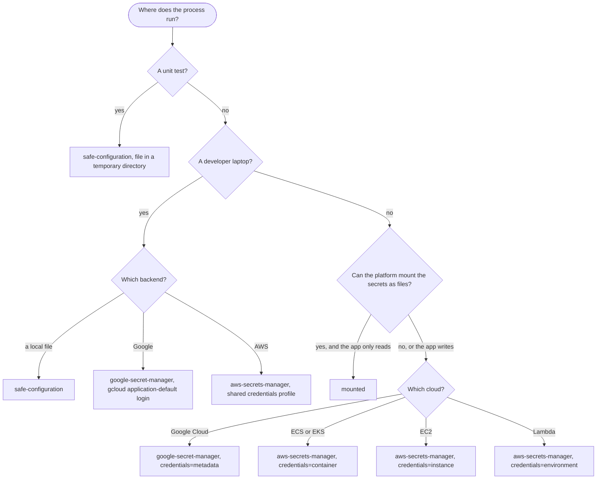
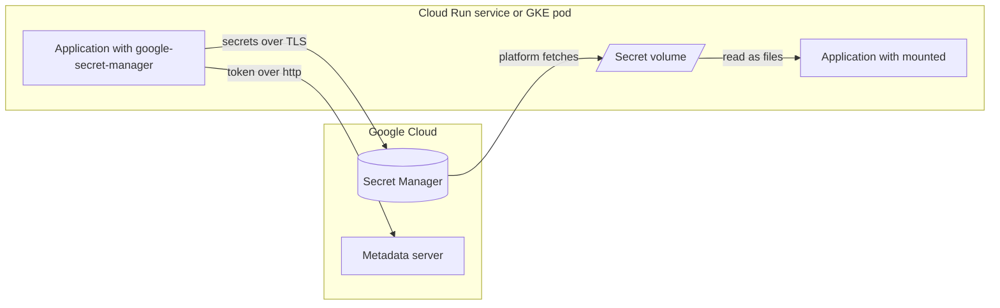
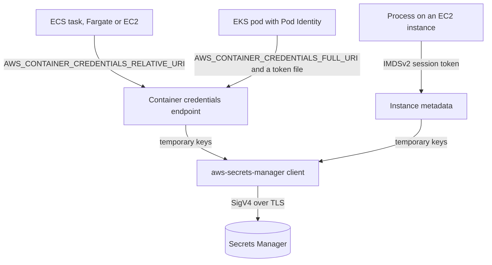
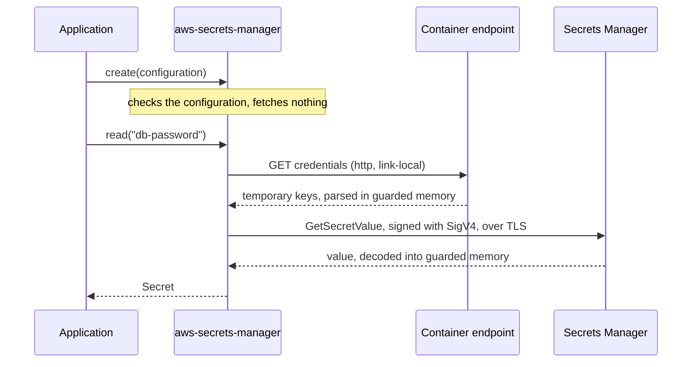

# Deployment models

The application code is the same everywhere: it calls `SecretManagerClient.create(configuration)` and reads
`Secret`s. What changes from one environment to the next is the configuration map, the JVM's flags, the container
image and the permissions of the identity the process runs as. This page goes through each environment the code
supports. [The API](api.md#creating-a-client) shows how to build the map from the application's own configuration,
and each provider's page lists every key it reads.

## What every deployment needs

These hold in every environment except a test that turns guarded memory off.

Need | Why | How
---|---|---
Java 25 | the library is compiled for Java 25 | a Java 25 JRE in the image
Native access | guarded memory calls the C library; without it, `create` refuses | `java --enable-native-access=io.descoped.secrets.api` on the module path, `--enable-native-access=ALL-UNNAMED` on the class path
Linux or macOS, x86_64 or aarch64 | guarded memory refuses elsewhere | any Linux base image
OpenSSL 3 | TLS for both network providers, and SigV4 signing for AWS | Debian and Ubuntu: `libssl3` (`libssl3t64` on Ubuntu 24.04); macOS: `brew install openssl@3`
A locked-memory limit that fits the secrets | values are locked with `mlock`; a limit too low fails with "Cannot lock" | `ulimit -l`, `docker run --ulimit memlock=...`, an ECS task's `ulimits`
A seccomp profile that allows the memory calls | if the platform filters system calls | [the list](security.md#what-the-platform-must-provide)

The file-based providers, `safe-configuration` and `mounted`, do not load OpenSSL. The Google provider loads it
only when something is reached over https, which is always the case for the real Google endpoints. The AWS provider
always needs it, since it signs every request with HMAC-SHA256 through `libcrypto`, and the real AWS endpoints are
https too.

[What the platform must provide](security.md#what-the-platform-must-provide) is the home of these requirements and
of the table of platforms the library has been verified on. This page does not repeat that table.

## Choosing a provider and a credential source



### Network provider or mounted files

Both keep values in guarded memory from the moment they are read. They differ in what the process holds and what it
can do.

Question | Network provider (`google-secret-manager`, `aws-secrets-manager`) | `mounted`
---|---|---
Credential in the process | an OAuth token (access or refresh) or AWS keys, in guarded memory | none
Network code in the process for secrets | HTTP/1.1 and TLS through OpenSSL | none
OpenSSL in the image | required | not needed
Writes (`addVersion`) | yes, and creates a secret if needed | no, `UnsupportedOperationException`
Choice of version at read time | any version the backend has | only what the platform mounted (`latest`)
Rotation | the next `read` sees the new current version | the next `read` sees the file the platform replaced
Platforms | anywhere the process can reach the API | Cloud Run, Kubernetes, the Secrets Store CSI driver

Choose `mounted` where the platform mounts secrets and the application only reads them: the process then holds no
credential at all. Choose a network provider when the application writes versions, needs a specific version, or runs
where nothing mounts secrets.

Do not hand secrets to the process as environment variables, which Cloud Run, ECS task definitions and Kubernetes
all offer. The JVM keeps its environment as `String`s on the heap for its whole life, out of reach of guarded memory.
Mount them as files instead.

## A container image

The live tests on Cloud Run, ECS on Fargate and EC2 ran in an image like this one, built on `eclipse-temurin:25-jre`
with OpenSSL 3 added:

```dockerfile
FROM eclipse-temurin:25-jre

# OpenSSL 3 for TLS and SigV4 (libssl3 on Debian and older Ubuntu releases).
RUN apt-get update \
    && apt-get install -y --no-install-recommends libssl3t64 \
    && rm -rf /var/lib/apt/lists/*

WORKDIR /app
COPY target/app.jar /app/app.jar

# Class path: native access for the unnamed module.
ENTRYPOINT ["java", "--enable-native-access=ALL-UNNAMED", "-jar", "/app/app.jar"]
```

On the module path, name the API module instead:

```dockerfile
COPY target/modules/ /app/modules/
ENTRYPOINT ["java", "--enable-native-access=io.descoped.secrets.api", \
            "--module-path", "/app/modules", "--module", "com.example.app/com.example.app.Main"]
```

The flag must be on the `java` command line in the entrypoint. A client created without it fails with "Guarded
memory needs native access". Minimal and distroless images may lack `libssl.so.3`; without it, a network client with
an https endpoint cannot be created, and the error says so. An image that runs only `mounted` or
`safe-configuration` does not need the package.

## A developer laptop

On a laptop, start the JVM with the same native-access flag; an IDE run configuration takes it as a VM option. On
macOS, the network providers need `brew install openssl@3`: only Homebrew's locations are searched.

### A local file

```java
Map<String, String> configuration = Map.of(
        "secrets.provider", "safe-configuration",
        "secrets.property-resource-path", "/Users/me/app/dev.secrets");
```

The file must exist. `addVersion` rewrites it owner-only (`rw-------`). The format and its rules are on the
[safe-configuration](providers/safe-configuration.md) page.

### Google Secret Manager with your own login

Run `gcloud auth application-default login` once. The client then finds the `authorized_user` file it wrote, as
Application Default Credentials do:

```java
Map<String, String> configuration = Map.of(
        "secrets.provider", "google-secret-manager",
        "secrets.project-id", "my-dev-project");
```

To use another file, set `secrets.credentials-path`. A service-account key file is refused: the provider signs
nothing with a private key. The order in which the client looks for credentials is on the
[google-secret-manager](providers/google-secret-manager.md#credentials) page.

### AWS Secrets Manager with a profile

The client reads the shared credentials file (`~/.aws/credentials`, or the file `AWS_SHARED_CREDENTIALS_FILE`
names). It reads only that file: a profile that exists only in `~/.aws/config`, such as an SSO profile, is not
read. Put temporary keys into the credentials file, for example with `aws configure export-credentials`; the client
reads temporary keys from the file again every minute.

```java
Map<String, String> configuration = Map.of(
        "secrets.provider", "aws-secrets-manager",
        "secrets.region", "eu-north-1",
        "secrets.aws-profile", "dev");
```

Naming the profile (or `secrets.credentials=profile`) keeps the client from looking further. If `AWS_ACCESS_KEY_ID`
is set in the shell and no profile is named, `create` refuses rather than use keys from the environment.

## Google Cloud: Cloud Run and GKE



### With the metadata server

On Cloud Run, the process gets the token of the service account attached to the service. On GKE, it gets the token
of the Kubernetes service account's Workload Identity binding. In both, pin the metadata server, so that no file on
the machine is ever considered:

```java
Map<String, String> configuration = Map.of(
        "secrets.provider", "google-secret-manager",
        "secrets.project-id", "my-project",
        "secrets.credentials", "metadata");
```

`secrets.credentials=metadata` and `secrets.credentials-path` exclude each other; `create` refuses both at once. The
metadata server is reached over plain http at `metadata.google.internal`; Secret Manager over TLS through OpenSSL.

The identity needs these roles, on the project or on each secret:

Operation | Role
---|---
`read` | `roles/secretmanager.secretAccessor`
`addVersion` on an existing secret | `roles/secretmanager.secretVersionAdder` (or `secretVersionManager`)
`addVersion` on a secret that does not exist yet | in addition, `secretmanager.secrets.create` on the project

The [permissions table](providers/google-secret-manager.md#permissions) is the home of this list. A missing
permission is a `SecretManagerException` naming `PERMISSION_DENIED`.

### With secret volumes

Cloud Run mounts Secret Manager secrets as files. Give each secret a directory of its own under one parent, and point
the client at the parent:

```sh
gcloud run deploy my-service \
    --set-secrets=/secrets/db/password=db-password:latest,/secrets/api/key=api-key:latest
```

```java
Map<String, String> configuration = Map.of(
        "secrets.provider", "mounted",
        "secrets.mounted.directory", "/secrets");
// client.read("db/password"), client.read("api/key")
```

On GKE, the Secrets Store CSI driver with its Google provider mounts secrets in the same way: point
`secrets.mounted.directory` at the volume's `mountPath`. The application's identity needs no Secret Manager role;
the identity the platform uses to fetch the secrets does. The details are on the
[mounted](providers/mounted.md#platforms) page.

### Image and limits on Google Cloud

Cloud Run's second-generation execution environment has passed the live tests with guarded memory locked as by
default and `memfd_secret` in use. Kubernetes has no pod field for the locked-memory limit: it comes from the
container runtime on the node. If a client fails with "Cannot lock" on GKE, raise the limit in the runtime's
configuration or, accepting swap as a leak path, set `secrets.memory.lock=preferred`.

## AWS: ECS, EC2 and EKS



On every AWS platform, the client fetches temporary credentials on the first request, holds them in guarded memory,
and fetches them again five minutes before they expire. Pin the source in production, so that a stray file or
variable in the image cannot change it.

### ECS on Fargate or EC2, with a task role

ECS sets `AWS_CONTAINER_CREDENTIALS_RELATIVE_URI` in each container of a task with a task role. The client reads the
role's credentials from `169.254.170.2`:

```java
Map<String, String> configuration = Map.of(
        "secrets.provider", "aws-secrets-manager",
        "secrets.region", "eu-north-1",
        "secrets.credentials", "container");
```

`secrets.region` may be left out when `AWS_REGION` or `AWS_DEFAULT_REGION` is set. In the task definition, set the
`memlock` ulimit if the default is too low; Fargate's default worked in the live test. Fargate blocks `memfd_secret`,
so guarded memory there uses locked anonymous pages, which stay in the kernel's direct map.



### EC2, with an instance profile

On an EC2 instance, the client takes the instance profile's credentials from instance metadata, with IMDSv2 only:

```java
Map<String, String> configuration = Map.of(
        "secrets.provider", "aws-secrets-manager",
        "secrets.region", "eu-north-1",
        "secrets.credentials", "instance");
```

Require IMDSv2 on the instance (`HttpTokens=required`). When the application runs in a container on the instance,
the response to the PUT for the session token crosses one more network hop, so set the instance's metadata hop
limit to 2. The client never falls back to IMDSv1.

### EKS

**Pod Identity** works through the same container endpoint as ECS. The Pod Identity agent sets
`AWS_CONTAINER_CREDENTIALS_FULL_URI` and `AWS_CONTAINER_AUTHORIZATION_TOKEN_FILE` in the pod; the client reads the
token from that file on each fetch and sends it from guarded memory. Use `secrets.credentials=container` as on ECS.
A token given in the environment variable `AWS_CONTAINER_AUTHORIZATION_TOKEN` instead of a file is refused.

**The Secrets Store CSI driver** with its AWS provider mounts Secrets Manager secrets as files; use `mounted` with
`secrets.mounted.directory` at the volume's `mountPath`, as on GKE.

**IRSA** (web identity, `AWS_WEB_IDENTITY_TOKEN_FILE`) is not supported yet: the default chain refuses it and points
to Pod Identity. It is on the [roadmap](roadmap.md), as is a live run on a real EKS cluster; both EKS paths above
have been tested only locally.

### Permissions on AWS

The identity, whether a task role, an instance profile or a Pod Identity role, needs:

Operation | Actions
---|---
`read` | `secretsmanager:GetSecretValue`
`addVersion` on an existing secret | `secretsmanager:PutSecretValue`
`addVersion` on a secret that does not exist yet | in addition, `secretsmanager:CreateSecret`
`addVersion` creating a secret with `secrets.replica-regions` | in addition, `secretsmanager:ReplicateSecretToRegions`
Any of these on a secret encrypted with a customer managed KMS key (`secrets.kms-key-id`) | in addition, `kms:Decrypt` to read and `kms:GenerateDataKey` to write, on that key

`addVersion` tries `PutSecretValue` first and calls `CreateSecret` only when the secret is missing, so a role that
only writes existing secrets needs no `CreateSecret`. Limit the resource to the secrets the application uses, by name
prefix. The client makes no other call: it never lists, describes or deletes secrets. A missing permission is a
`SecretManagerException` naming `AccessDeniedException`.

## AWS Lambda

Lambda gives a function its role's credentials only as environment variables (`AWS_ACCESS_KEY_ID`,
`AWS_SECRET_ACCESS_KEY`, `AWS_SESSION_TOKEN`). The client refuses them by default, because the JVM holds its
environment as `String`s on the heap for its whole life. Opt in explicitly:

```java
Map<String, String> configuration = Map.of(
        "secrets.provider", "aws-secrets-manager",
        "secrets.credentials", "environment");      // region from AWS_REGION, which Lambda sets
```

What this costs: the role's keys are on the heap, outside the library's guarantee, whatever the client does. The
client still copies them into guarded memory for signing, and secret values still never reach the heap. A heap dump
of the function would hold the keys but not the values. Lambda has not been among the platforms verified. The JVM
still needs the native-access flag, so use a container image whose entrypoint passes it, as above. If the function
fails with "Cannot lock", `secrets.memory.lock=preferred` runs it with unlocked memory, which is logged once.

## Tests

A unit test that only needs some secrets uses `safe-configuration` with a file in a JUnit `@TempDir`, never a fixed
path:

```java
@TempDir
Path dir;

@Test
void readsTheDatabasePassword() throws IOException {
    Path file = dir.resolve("test.secrets");
    Files.writeString(file, "db.password=not-a-real-secret\n");
    try (SecretManagerClient client = SecretManagerClient.create(Map.of(
            "secrets.provider", "safe-configuration",
            "secrets.property-resource-path", file.toString(),
            "secrets.memory.guard", "off"));
         Secret password = client.read("db.password")) {
        assertEquals("not-a-real-secret", password.withChars(String::new));
    }
}
```

`secrets.memory.guard=off` gives plain off-heap memory: no guard pages, no locking, no access control, and no
native access needed. It is meant for tests only. To test with guarded memory as in production, leave the key out
and give the test JVM the flag, for example through Surefire's `argLine`:

```xml
<plugin>
    <groupId>org.apache.maven.plugins</groupId>
    <artifactId>maven-surefire-plugin</artifactId>
    <configuration>
        <argLine>--enable-native-access=ALL-UNNAMED</argLine>
    </configuration>
</plugin>
```

Use `--enable-native-access=io.descoped.secrets.api` instead when the tests run on the module path. Every provider
follows the same contract ([The API](api.md#the-contract)), so a test against `safe-configuration` exercises the
same error handling the application meets in production.

## Summary

Environment | Provider | Key settings | Credential in the process
---|---|---|---
Laptop | `safe-configuration` | `secrets.property-resource-path` | none
Laptop | `google-secret-manager` | `secrets.project-id` | your `authorized_user` refresh token
Laptop | `aws-secrets-manager` | `secrets.region`, `secrets.aws-profile` | keys from the credentials file
Cloud Run, GKE | `google-secret-manager` | `secrets.project-id`, `secrets.credentials=metadata` | an access token
Cloud Run, GKE | `mounted` | `secrets.mounted.directory` | none
ECS, EKS Pod Identity | `aws-secrets-manager` | `secrets.region`, `secrets.credentials=container` | temporary keys
EC2 | `aws-secrets-manager` | `secrets.region`, `secrets.credentials=instance` | temporary keys
EKS with the CSI driver | `mounted` | `secrets.mounted.directory` | none
Lambda | `aws-secrets-manager` | `secrets.credentials=environment` | the role's keys, also on the heap
Tests | `safe-configuration` | a `@TempDir` file, `secrets.memory.guard=off` | none
