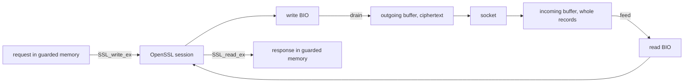
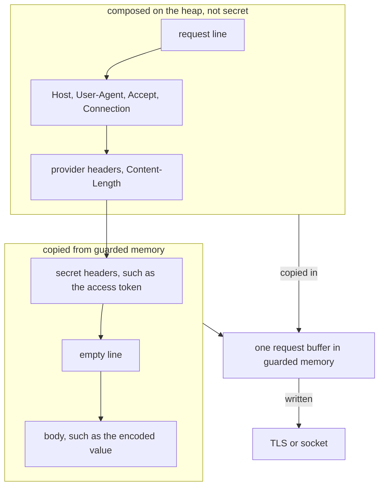
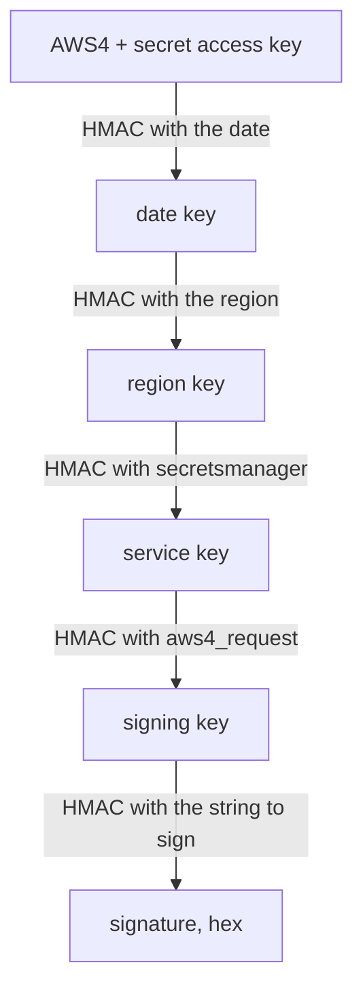
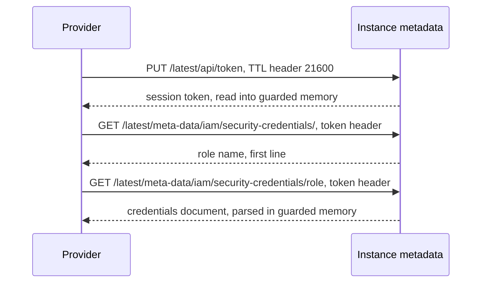

# Protocols

The network providers, [google-secret-manager](providers/google-secret-manager.md) and
[aws-secrets-manager](providers/aws-secrets-manager.md), speak HTTP/1.1 over TLS without the JDK's networking
stack above the socket. The API module holds the shared parts: TLS through the system's OpenSSL 3
(`io.descoped.secrets.api.tls`), HTTP/1.1, JSON and the encodings (`io.descoped.secrets.api.http`), and SHA-256 and
HMAC-SHA256 (`io.descoped.secrets.api.crypto`). Each is exported only to the provider modules. This page describes
what goes over the wire and where each byte is held on the way. Why secrets must stay off the Java heap is the topic
of the [security model](security.md); guarded memory itself is described in
[the API](api.md#guarded-memory-secretmemory-and-secret).

## Where each part runs

| Layer | Implementation | Secret bytes held in |
|---|---|---|
| Socket | a non-blocking `SocketChannel` with a `Selector` | over TLS, ciphertext only; over plain http, read straight into guarded memory |
| TLS | OpenSSL 3 `libssl` through the Foreign Function & Memory API, on memory BIOs | OpenSSL's native buffers, cleared |
| HTTP/1.1 | `Http` and `Connection` in the API module | guarded memory |
| JSON, Base64, form and JSON escapes, CRC32C | `Json` and `Codec`, in place on memory segments | guarded memory |
| SHA-256, HMAC-SHA256 | OpenSSL 3 `libcrypto` (`Sha256`) | guarded memory, and OpenSSL's cleared state |

Plain HTTP is used only where the platform's protocol is plain HTTP on a link-local address (the Google metadata
server, the container credentials endpoint of ECS and EKS Pod Identity, EC2 instance metadata) and for loopback test
servers. Every other endpoint must use https; a configuration that names an http endpoint on another host is refused
when the client is created. No proxy is used: connections go straight to the endpoint.

## TLS

TLS is done by the system's OpenSSL 3, called through the Foreign Function & Memory API. The JDK's `SSLEngine` is not
used, because it copies plaintext through heap arrays. Nothing is bundled: on Linux the library is `libssl.so.3`
with `libcrypto.so.3`, on macOS Homebrew's `openssl@3` (under `/opt/homebrew` or `/usr/local`). Other operating
systems, and an OpenSSL older than 3.0, are refused; when the library is not found, the message says what to install.
OpenSSL is loaded only when a client reaches something over https, or signs AWS requests.

### Settings

One TLS context is created per client, and one session per connection. The context sets:

- **Versions**: TLS 1.2 at least, TLS 1.3 at most.
- **TLS 1.3 suites**: `TLS_AES_128_GCM_SHA256`, `TLS_AES_256_GCM_SHA384`, `TLS_CHACHA20_POLY1305_SHA256`.
- **TLS 1.2 ciphers**: `ECDHE+AESGCM:ECDHE+CHACHA20`, so ECDHE key exchange with AES-GCM or ChaCha20-Poly1305 only.
- **Options**: `SSL_OP_CLEANSE_PLAINTEXT` (OpenSSL clears decrypted data from its buffers once it is handed over,
  and when the session is freed), `SSL_OP_NO_COMPRESSION` and `SSL_OP_NO_RENEGOTIATION`.
- **Session mode**: `SSL_MODE_RELEASE_BUFFERS`, so record buffers are freed while idle instead of holding plaintext.
- **Peer verification**: `SSL_VERIFY_PEER`. The trusted roots are OpenSSL's default locations, or, when the provider
  is given `secrets.tls.ca-file`, only the certificates in that PEM file. `javax.net.ssl.trustStore` does not apply.

### Certificate and host checks

For a host name, the session sets the expected name (`SSL_set1_host`) and sends it as SNI. For an IP literal (IPv4,
or IPv6 without brackets), it sets the expected address instead and sends no SNI. When the handshake completes, the
session checks once more that the server sent a certificate and that OpenSSL's verify result is `X509_V_OK`. A
certificate that does not chain to a trusted root, or does not match the name or address, fails the handshake with
OpenSSL's verify error in the message. `TlsSessionTest` covers a host name, an IPv4 and an IPv6 address, another
name, another address and an untrusted certificate.

### Memory BIOs

OpenSSL never touches the socket. Each session has two memory BIOs: one that the connection feeds with ciphertext
from the network, and one it drains of ciphertext to send. Plaintext goes straight between guarded memory and
OpenSSL through `SSL_write_ex` and `SSL_read_ex`. The connection's own buffers are direct buffers that hold only TLS
records, and only whole records are handed to OpenSSL.



The connection waits for data with no guarded memory open. Only once a whole record has arrived does it open a
guarded buffer and decrypt into it, so a slow server never keeps guarded memory writable. The server's
`close_notify`, or the end of the TCP stream, ends the stream; a response that is not complete by then fails.

## HTTP/1.1

`Http` implements the part of HTTP/1.1 the providers need, and no more.

### Connections and timeouts

- **One connection per request.** Every request carries `Connection: close`, and the connection is closed when the
  response has been read. There is no connection pool, no keep-alive and no pipelining.
- **No retries and no redirects.** A request is sent once. A 3xx status is returned to the provider like any other
  status, and the providers treat it as an error.
- **Connect timeout** (`secrets.connect-timeout`, default 10 seconds) covers the host name lookup and the TCP connect.
  The JDK's resolver has no timeout of its own, so the lookup runs on a virtual thread that the caller waits for
  until the deadline.
- **Request timeout** (`secrets.request-timeout`, default 30 seconds) is one deadline for the whole exchange: the
  connect, the TLS handshake, writing the request and reading the response. Every wait on the socket is bounded by it.
- Both timeouts are ISO-8601 durations, at most one hour. A timeout or an interrupt fails the call with a
  `SecretManagerException`; the thread's interrupt flag is restored.

### Request anatomy

A request is built in one piece of guarded memory and written to the connection from there. The head lines that hold
nothing secret are composed as a `String`, then copied in. Headers whose values are secret are written after them,
straight from the secret's own guarded memory, and so is the body.



Every request has these lines, in this order:

```http
<METHOD> <base path><path> HTTP/1.1
Host: <host>[:<port>]
User-Agent: descoped-secrets-client
Accept: application/json
Connection: close
<provider headers>
Content-Length: <n>          (only with a body)
<secret headers>

<body>
```

The `Host` header carries the port only when it is not the scheme's default, and brackets an IPv6 address. Before a
request is built, every secret header value is checked for control characters: a byte below 0x20 other than tab, or
0x7F. One is refused with an `IllegalArgumentException` that names the header but not the value, because a line
break in a token would end the header and start another.

### Responses

A response is read in bursts. Each burst is read into a guarded buffer only after its bytes have arrived, then kept at
its exact size; when the response is complete, the body is assembled from the bursts into one `Secret`.

- The status line must be `HTTP/1.1` or `HTTP/1.0` with a status from 200 to 599; an interim 1xx response is refused.
- The head (status line and headers) is collected on the heap, since it holds nothing secret. It may be at most
  64 KiB.
- The body is framed by `Content-Length` or by `Transfer-Encoding: chunked`. Chunk extensions and trailers are
  skipped. A response with neither framing is refused: the end of the connection never marks the end of a body.
  A 204 or 304 has no body.
- A body may be at most 4 MiB. A larger `Content-Length` or chunk total, two different `Content-Length` values,
  bytes after the end of the response, or a connection that closes before the end, each fail the exchange.

## JSON and Base64

The providers read JSON and encode values without a copy on the heap.

- **Reading.** `Json` parses RFC 8259 in place on the response's guarded memory, strict about structure and escapes;
  bytes above 0x7F are not checked as UTF-8. Strings and numbers are returned as spans of that memory, not copied.
  Duplicate keys, control characters in strings and nesting deeper than 32 levels are refused. The parser makes
  `String`s only of object keys, which are never secret; a provider makes one only of a field that is not secret,
  such as a version name or an error message. A secret string, such as a token or a value, is unescaped from its
  span straight into a new `Secret`. Error messages never quote the input.
- **Escapes.** Unescaping handles the short escapes and `\uXXXX`, joins surrogate pairs and writes UTF-8. Escaping a
  value for a JSON string escapes the quote and the backslash, writes other control characters as short escapes or
  `\u00XX`, and copies every other byte as it is.
- **Base64.** The standard alphabet (`+` and `/`). Encoding writes padding. Decoding accepts the value with or without
  padding, but no line breaks or other characters. When a Base64 string in a response holds escapes, such as `\/`,
  it is unescaped into guarded memory first and decoded from there.
- **Form encoding** (`application/x-www-form-urlencoded`). Every byte except letters, digits and `-._~` is written as
  `%XX`, from guarded memory into guarded memory.
- **CRC32C** is computed in place on the value with the JDK's `CRC32C`, which reads a direct buffer without a heap
  copy.

## Google Secret Manager

The provider calls the Secret Manager REST API v1 at `https://secretmanager.googleapis.com` by default
(`secrets.endpoint`). Every call carries `Authorization: Bearer <access token>` as a secret header. Calls with a body
add `Content-Type: application/json`. All paths start with `/v1/projects/<project>`.

| Operation | Request | Body sent | Read from the response |
|---|---|---|---|
| Read a version | `GET .../secrets/<id>/versions/<version>:access` | none | `payload.data`, `payload.dataCrc32c` |
| Add a version | `POST .../secrets/<id>:addVersion` | `{"payload":{"data":"<Base64>","dataCrc32c":"<decimal>"}}` | `name`, whose last segment is the version |
| Create a secret | `POST .../secrets?secretId=<id>` | `{"replication":{"automatic":{}}}`, or `userManaged` replicas | status only |

- A secret id must be 1 to 255 letters, digits, `-` and `_`, and a version `latest` or a number. A read outside that
  rule is a `SecretNotFoundException` without a request.
- On a read, a 404 is a `SecretNotFoundException`. The value is decoded from Base64 straight into the `Secret` that
  `read` returns. When `payload.dataCrc32c` is present, the CRC32C of the decoded value must equal it, or the read
  fails.
- On `addVersion`, the body is built in guarded memory: the value Base64-encoded, and its CRC32C as a decimal
  string. A 404 means the secret does not exist: the provider creates it and posts the version again. A 409 on the
  create means someone else created it meanwhile, which is accepted.
- An error names the HTTP status and Google's `error.status` and `error.message`, never the response body.

### OAuth refresh-token grant

With `authorized_user` credentials, as `gcloud auth application-default login` writes them, the refresh token is
exchanged for an access token at `https://oauth2.googleapis.com/token` (`secrets.token-endpoint`):

```http
POST /token HTTP/1.1
Content-Type: application/x-www-form-urlencoded

grant_type=refresh_token&client_id=<id>&client_secret=<secret>&refresh_token=<token>
```

The client secret and the refresh token are form-encoded from guarded memory into a guarded body. The response's
`access_token` is unescaped into guarded memory, and `expires_in` gives its lifetime (an hour when absent). On an
error, only the HTTP status and OAuth's `error` code, such as `invalid_grant`, are reported.

### Metadata server

On Google Cloud, the token of the attached service account comes from the metadata server, over plain HTTP:

```http
GET /computeMetadata/v1/instance/service-accounts/default/token HTTP/1.1
Host: metadata.google.internal
Metadata-Flavor: Google
```

The endpoint (`secrets.metadata-endpoint`) must be http on `metadata.google.internal`, `169.254.169.254` or a loopback
address. The response has the same shape as the OAuth response and is read the same way.

An access token from either source is kept in guarded memory and fetched anew three minutes before it expires. Which
source a client uses is described on the [provider page](providers/google-secret-manager.md#credentials).

## AWS Secrets Manager

The provider calls the Secrets Manager JSON 1.1 API at `https://secretsmanager.<region>.amazonaws.com` by default
(`amazonaws.com.cn` in the China regions; `secrets.endpoint` to change it). Every call is `POST /` with these headers:

| Header | Value |
|---|---|
| `Content-Type` | `application/x-amz-json-1.1` |
| `X-Amz-Date` | the signing time, `yyyyMMdd'T'HHmmss'Z'` in UTC |
| `X-Amz-Target` | `secretsmanager.<Operation>` |
| `Authorization` | `AWS4-HMAC-SHA256 Credential=<access key id>/<scope>, SignedHeaders=<list>, Signature=<hex>` |
| `X-Amz-Security-Token` | the session token, for temporary credentials only; a secret header |

The operations used:

| Operation | Body sent | Read from the response |
|---|---|---|
| `GetSecretValue` | `SecretId`, and `VersionId` or `VersionStage` | `SecretString` or `SecretBinary` |
| `PutSecretValue` | `SecretId`, `ClientRequestToken`, `SecretString` or `SecretBinary` | `VersionId` |
| `CreateSecret` | `Name`, `ClientRequestToken`, `KmsKeyId` and `AddReplicaRegions` when configured, the value | `VersionId` |

- A value that is valid UTF-8 is sent as `SecretString`, escaped for JSON in guarded memory; any other value as
  `SecretBinary`, Base64-encoded in guarded memory. A response's `SecretString` is unescaped, and its `SecretBinary`
  decoded, straight into the `Secret` that `read` returns.
- Each write carries a new random UUID as its `ClientRequestToken`, which becomes the version ID.
- `addVersion` sends `PutSecretValue`. On `ResourceNotFoundException` it sends `CreateSecret` with the value, and on
  `ResourceExistsException` from that (created meanwhile) it sends `PutSecretValue` once more.
- Errors are read from `__type`, without the namespace before `#`, and `message` or `Message`. The response body is
  never quoted.

How names and versions map to these fields is described on the
[provider page](providers/aws-secrets-manager.md#versions-and-values).

### Signature Version 4

Every request is signed with SigV4 for the service `secretsmanager`. SHA-256 and HMAC-SHA256 come from OpenSSL's
`libcrypto` (`Sha256`), because the JDK's `Mac` copies its key into a heap array and `MessageDigest` buffers through
heap arrays.

1. **Payload hash.** The body, which may hold the value, is hashed with SHA-256 in place in guarded memory.
2. **Canonical request.** The provider builds:

   ```text
   POST
   /

   content-type:application/x-amz-json-1.1
   host:<host>
   x-amz-date:<timestamp>
   x-amz-security-token:<session token>
   x-amz-target:secretsmanager.<Operation>

   content-type;host;x-amz-date;x-amz-security-token;x-amz-target
   <hex SHA-256 of the body>
   ```

   The query string is empty. The `x-amz-security-token` line and its entry in the signed headers are present only
   with temporary credentials. With them, the canonical request contains the session token, so it is built and
   hashed in guarded memory. Without them, it holds nothing secret and is built on the heap.
3. **String to sign.** `AWS4-HMAC-SHA256`, the timestamp, the scope `<date>/<region>/secretsmanager/aws4_request` and
   the hex SHA-256 of the canonical request, one per line. None of it is secret.
4. **Signing key and signature.** The key is derived anew for each request, in one guarded scratch buffer:



The secret access key and every derived key stay in guarded memory, and the buffer is wiped when the request has
been signed. Only the signature, which is not secret, is written to the heap. The signer is checked in the tests
against a reference written from AWS's description, which itself matches AWS's published signing-key example and the
vanilla requests of AWS's test suite.

### Session token

With temporary credentials, the session token goes out as `X-Amz-Security-Token`, written into the request from the
credentials' own guarded memory. It is the last header of the head, after the `Authorization` line.

### Container credentials endpoint

The ECS task role and EKS Pod Identity serve temporary credentials over HTTP:

- **ECS task role**: `AWS_CONTAINER_CREDENTIALS_RELATIVE_URI` is appended to `http://169.254.170.2`.
- **EKS Pod Identity and others**: `secrets.container-credentials-uri`, or else `AWS_CONTAINER_CREDENTIALS_FULL_URI`,
  gives the whole URI. Over http, its host must be `169.254.170.2`, `169.254.170.23`, `fd00:ec2::23` or a loopback
  address; over https, any host with a path.

The provider sends `GET` to that URI. With `AWS_CONTAINER_AUTHORIZATION_TOKEN_FILE`, it reads the token from the file
into guarded memory on each fetch, trims trailing whitespace, and sends it as `Authorization: <token>`, without a
scheme, as a secret header. The response is a JSON document with `AccessKeyId`, `SecretAccessKey`, `Token` and
`Expiration` (an ISO-8601 instant). It is parsed in guarded memory; the secret access key and the token are
unescaped into their own guarded memory, and only the access key ID and the expiration become `String`s.

### EC2 instance metadata (IMDSv2)

On EC2, the instance profile's credentials come from instance metadata at `http://169.254.169.254` (or
`fd00:ec2::254`, or a loopback test server), with IMDSv2 only. IMDSv1, without a token, is never used.



The `PUT` carries `X-aws-ec2-metadata-token-ttl-seconds: 21600`, the six hours IMDS allows. Both `GET`s carry the
session token as `X-aws-ec2-metadata-token`, a secret header sent from guarded memory. A new session token is fetched
for each credentials fetch. The role name must be 1 to 128 word characters or `+=,.@-`. The credentials document has
the same shape as the container endpoint's and is parsed the same way.

Temporary credentials from either endpoint are fetched again five minutes before they expire. Which source a client
uses, and in what order the chain tries them, is described on the
[provider page](providers/aws-secrets-manager.md#credentials).
