# Sequence flows

This page follows the main calls through the library, one diagram each. The notes in each diagram say where the
value, or a credential, is at that step. "Guarded memory" is
[`SecretMemory`](api.md#guarded-memory-secretmemory-and-secret): off the Java heap, locked, between guard pages
and with no access unless a call is using it. What these flows protect against, and where protection ends, is in
[the security model](security.md). Configuration keys and error tables are on the provider pages.

## Creating a client

`SecretManagerClient.create` checks that `secrets.provider` is set and hands the search to `ServiceLoader`. Every
`SecretManagerClientInitializer` on the module path or the class path is listed, and the one whose provider name
matches is used. No match, or more than one, is a `ProviderException`. A key the provider declares as required and
the map lacks is an `IllegalArgumentException`, before the provider runs.

The initializer checks its own keys first (endpoints, timeouts, the directory or file), and for an https endpoint
loads OpenSSL. Then it creates the client's guarded memory. `SecretMemory.create` refuses to start on an unsupported
platform, and when the JVM was started without `--enable-native-access` for the API module. It then maps the first
slab: one page of data between two guard pages.

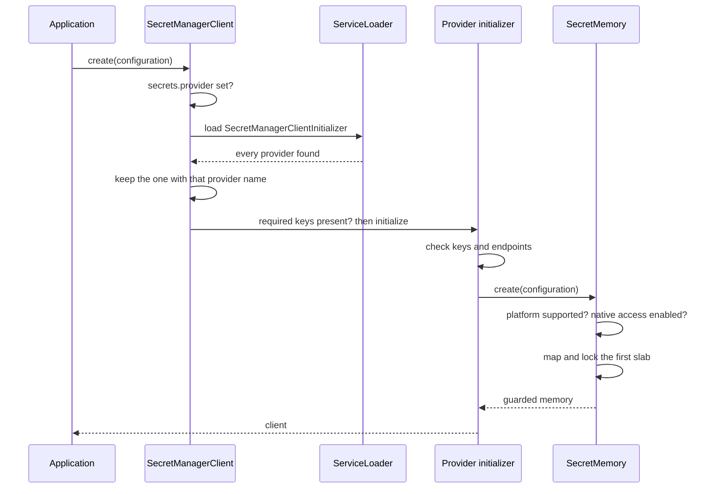

Mapping a slab is a fixed series of calls to the operating system. The data pages start without access, become
writable only while they are set up, and end without access again. A lock that fails is an error with
`secrets.memory.lock=required` (the default), and the message names the locked-memory limit.

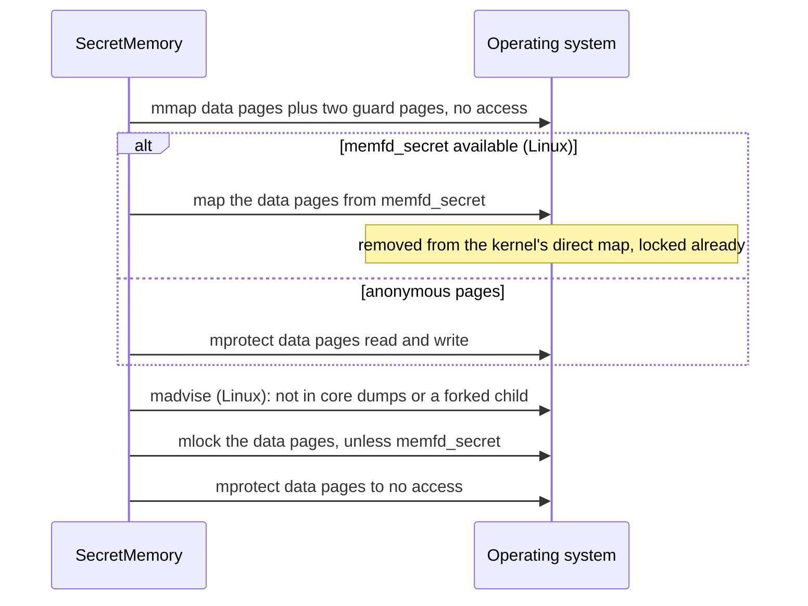

The network providers fetch no access token or credential at this point: the first request does. Files are another
matter. safe-configuration reads its secrets file now (see below), and the Google provider reads an
`authorized_user` file, if it uses one, into guarded memory.

## Using a secret

A caller reaches a value only inside a callback. `withSegment` hands over the value itself as a read-only segment.
`withBytes` and `withChars` hand over a heap copy, which is wiped when the callback returns. While the callback runs,
the secret's slab is readable. Protection is per page, so other secrets on the same slab are readable for that time
too. When the last reader of the slab is done, it goes back to no access.

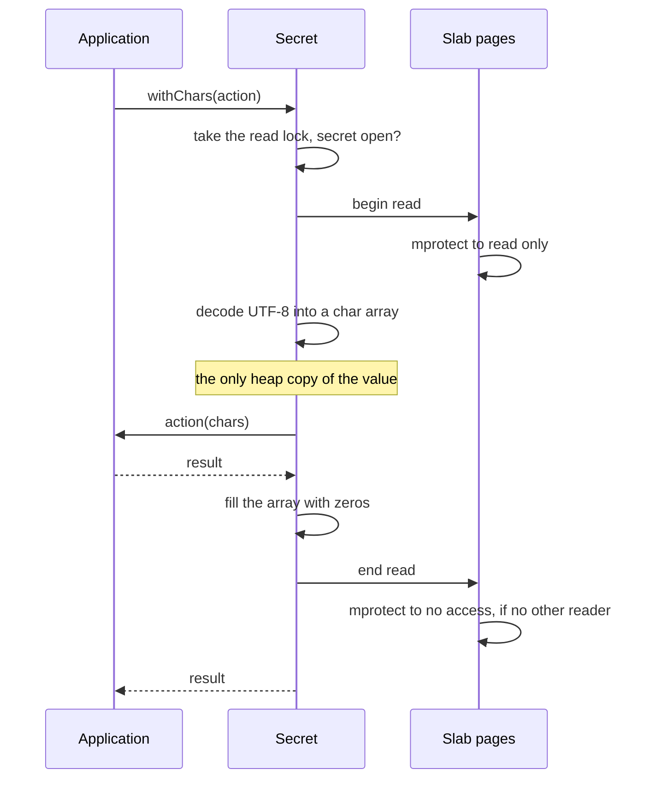

- `withSegment` skips the decoding and the array. The segment belongs to an arena that closes when the callback
  returns, and only the calling thread may use it, so it cannot be kept.
- `withChars` decodes strict UTF-8 itself. Invalid UTF-8 is a `SecretManagerException`, and the action never runs.
- `withBytes` copies the bytes into an array, and zeros it afterwards.
- A callback holds the secret's read lock, so a `close()` from another thread waits until it returns.

## Closing a secret

`close()` waits for callbacks in other threads, then wipes the block. A secret closed inside its own callback is an
`IllegalStateException`. A secret that becomes unreachable without being closed is found by a `Cleaner`, which logs
a warning and does the same.

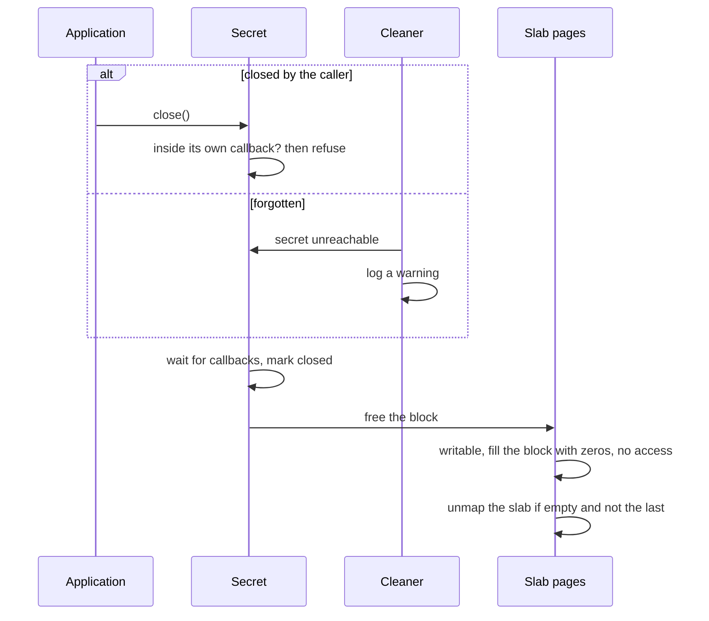

## Closing a client

Closing a client marks it closed, wipes the access token or the AWS credentials it holds, and closes its guarded
memory. That closes every secret the client returned and the caller has not closed yet, each after its running
callbacks. Then each slab is made writable, filled with zeros, unlocked if `mlock` locked it, and unmapped with
its guard pages. Last, the OpenSSL context is freed. `close()` is idempotent. A call after it is an
`IllegalStateException`.

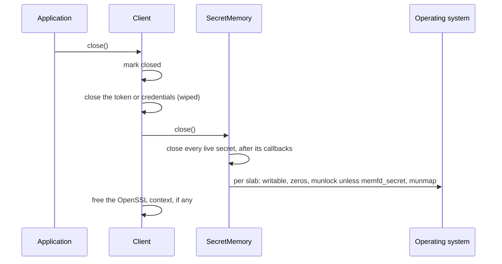

`SecretMemory` has a `Cleaner` of its own: memory that becomes unreachable without being closed is wiped and
unmapped, and that is logged.

## Reading a mounted file

The [mounted](providers/mounted.md) provider reads the file on every `read`. Before it touches the file system, it
checks the version (`latest` or `null`) and every segment of the name. A name that fails is a
`SecretNotFoundException`. The name is resolved to its real path, following links, and that path must lie inside
the directory. The file is then opened without following links.

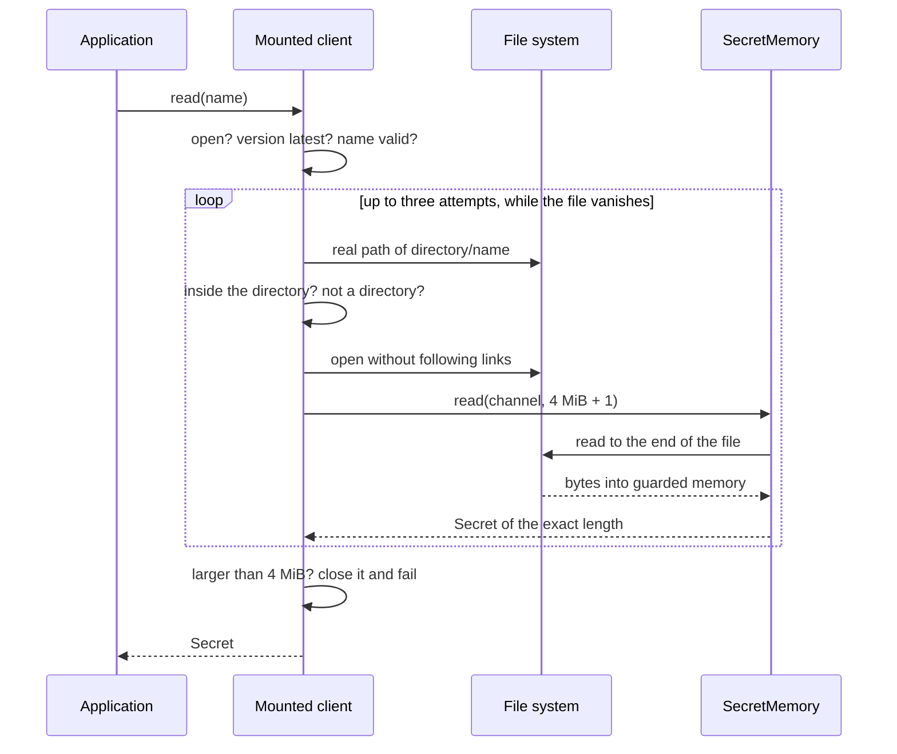

- A file that is gone when it is resolved or opened is resolved again, up to three attempts in all. That covers a
  Kubernetes rotation, which swaps a link and then removes the old files. After the third, it is a
  `SecretNotFoundException`.
- A link out of the directory is a `SecretManagerException`.
- The read lock of the client is held for the whole read, so `close()` waits for it.

`SecretMemory.read` sizes its first buffer from the file's size, and doubles it while it fills up. A larger buffer
gets the bytes read so far, and the smaller one is wiped. At the end, the bytes are copied into a secret of the
exact length, and the buffer is wiped. The kernel cannot pin `memfd_secret` pages, so it cannot fill them from a
FUSE or virtiofs volume. Where `memfd_secret` is available, every read therefore goes through a bounce buffer:

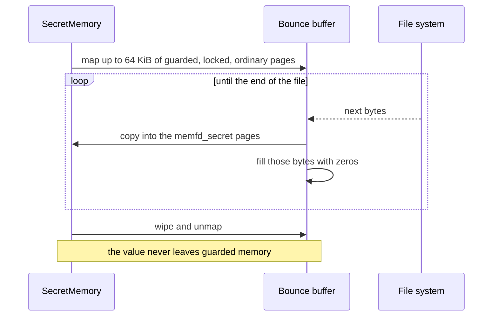

## Reading and writing a local file

The [safe-configuration](providers/safe-configuration.md) provider reads its file once, when the client is created.
It reads the file through `SecretMemory.read` into guarded memory and parses it in place. It copies each value into
a secret of its own, and wipes the file's content. Only the keys become `String`s. A `read` copies the stored value
into a new secret for the caller.

`addVersion` holds the client's write lock throughout. It reads the file again, so that edits to other keys made
since are kept, and replaces the file atomically:

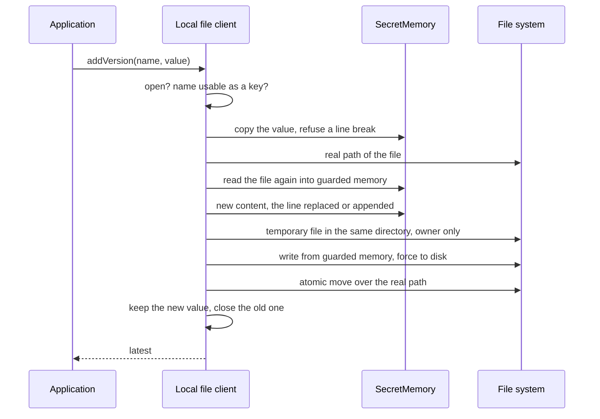

- Both copies of the file's content are closed, and so wiped, before `addVersion` returns.
- If anything fails, the temporary file is deleted and the new copy of the value is closed. The client keeps the
  old value, and the error is a `SecretManagerException`.
- The caller's `Secret` is only read. It stays the caller's to close.

## Google Secret Manager: reading

The [google-secret-manager](providers/google-secret-manager.md) provider checks the name and version against Secret
Manager's rules before it sends anything. A name or version that cannot exist is a `SecretNotFoundException`. The
request is built in guarded memory, with the access token in its `Authorization` header, and goes out over TLS
through OpenSSL. One connection carries one request.

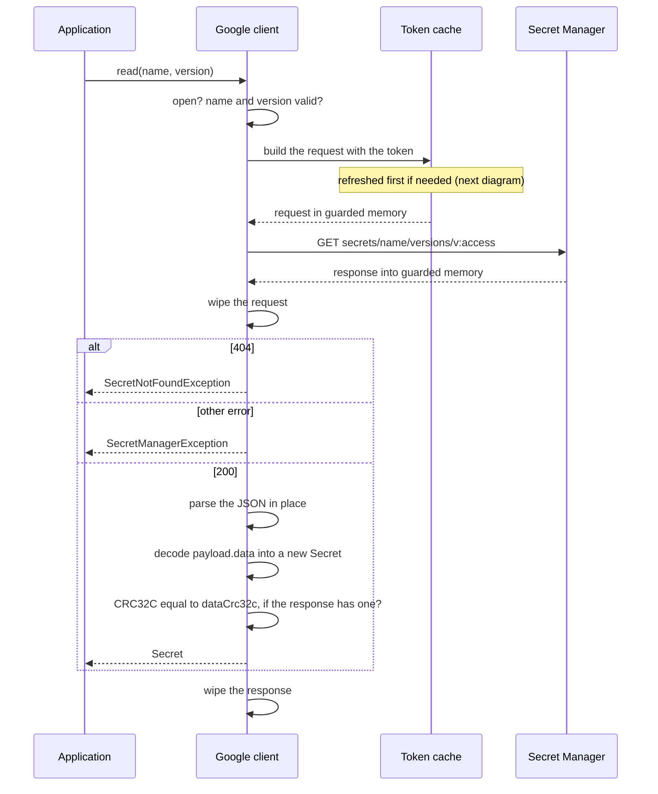

- The Base64 text is decoded straight from the response into the new secret. If the JSON escapes some of it, it is
  first unescaped into a temporary secret of its own.
- A response without `dataCrc32c` is not checked. A checksum that does not match closes the new secret, and is a
  `SecretManagerException`.
- A parse failure is a `SecretManagerException` that names the secret and the type of failure, with no cause chained.
- A timeout is a `SecretManagerException` that says so. An interrupt restores the thread's interrupt flag.

### The access token

The token cache holds one access token in guarded memory. It fetches a new one when it has none, or less than three
minutes are left. Readers share the token, and a refresh takes the write lock, so the token is never replaced while
a request is being built with it.

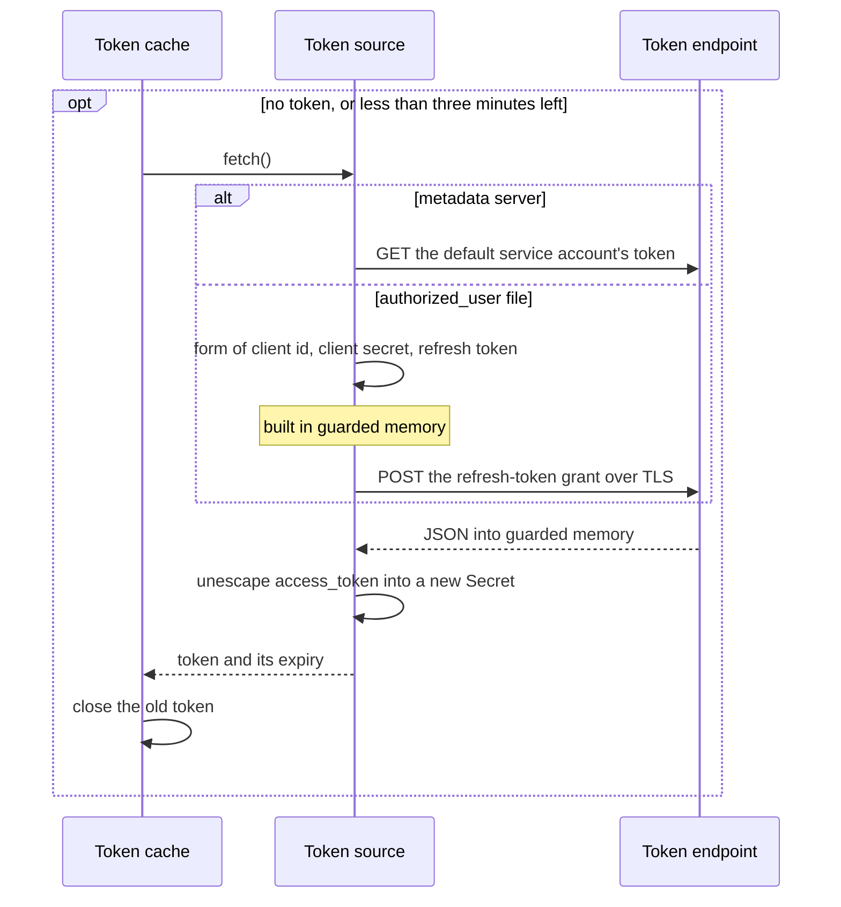

The `authorized_user` file is read into guarded memory when the client is created. Its client secret and refresh
token are kept there, each in a secret of its own. A response that is not 200 is a `SecretManagerException` with the
HTTP status, and for OAuth, the error code.

## Google Secret Manager: adding a version

The request body is built once, in guarded memory: the value in Base64 and its CRC32C checksum. Secret Manager
answers 404 when the secret does not exist. The client then creates it, with the configured replication, and posts
the same body again. A 409 on create means someone else created it meanwhile, which is just as good.

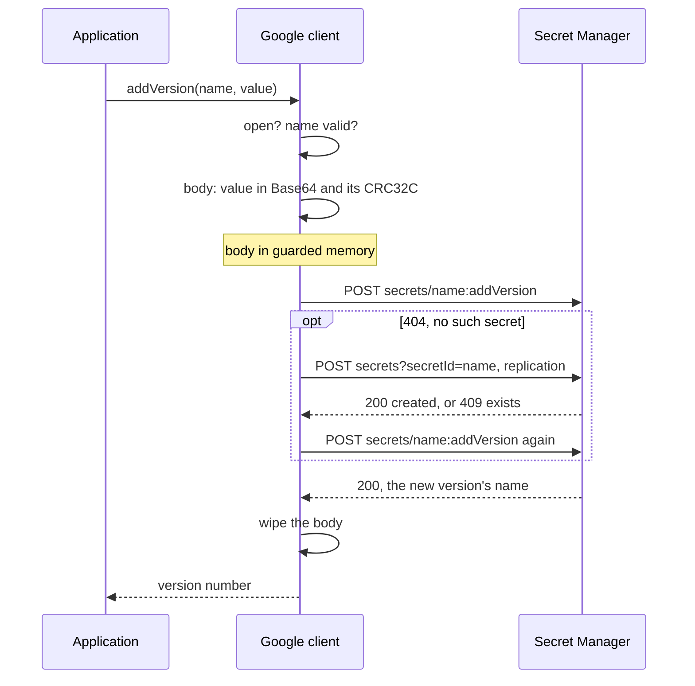

Any other error status, from either post or from the create, is a `SecretManagerException` with Google's error
status. The caller's `Secret` is only read.

## AWS Secrets Manager: reading

The [aws-secrets-manager](providers/aws-secrets-manager.md) provider maps `latest` (or `null`) to the stage
`AWSCURRENT`. A version that looks like a version ID and does not start with `AWS` is read as one, and any other is
read as a stage. The request body holds only the name and the version, so it is built on the heap. The request
itself is built in guarded memory, since it carries the session token when the credentials have one.

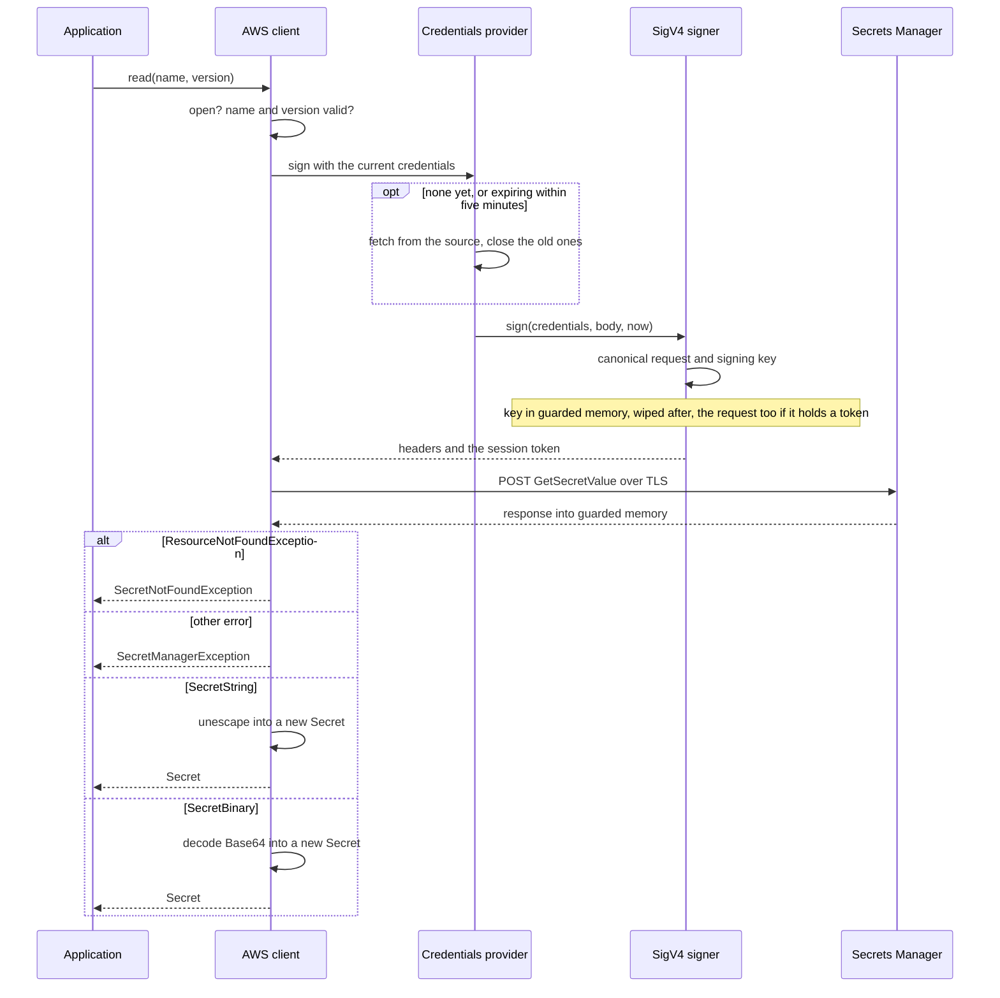

Signing follows Signature Version 4, and its details are on
[the provider page](providers/aws-secrets-manager.md#memory-signing-and-tls). With temporary credentials, the
canonical request includes the session token, so it is built and hashed in guarded memory; without one it holds
nothing secret and is built on the heap. The signing key is derived from the secret access key by four
HMAC-SHA256 steps in a guarded scratch area, a fifth signs the string to sign, and the scratch area is wiped when
the signature is done. The signature itself, and the access key ID, are not secret.

A source that cannot deliver credentials fails the call with a `SecretManagerException`. Nothing is sent to Secrets
Manager then.

## AWS Secrets Manager: adding a version

`addVersion` reads the caller's value in place for the whole call. Each request body is built in guarded memory
with a new client request token. A value that is valid UTF-8 is escaped into `SecretString`, and any other value is
encoded into `SecretBinary` as Base64. Every request is signed and sent as in the read above.

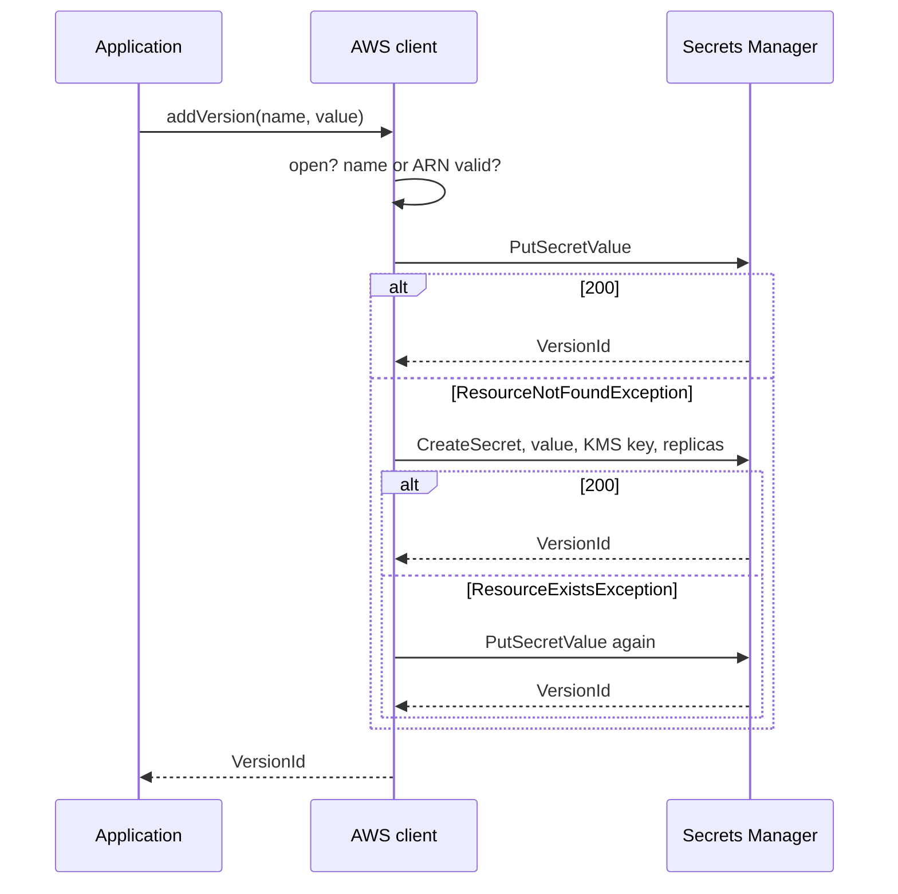

- Any other error is a `SecretManagerException` with the HTTP status and AWS's error type. So is an error from the
  second `PutSecretValue`.
- No request is retried after a timeout. Each body is wiped once its response has arrived.

## AWS credentials from the container endpoint

On ECS and on EKS Pod Identity, the credentials come from the container credentials endpoint. When a token file is
configured, the token is read from it on every fetch, since the platform rotates it. A token in an environment
variable is refused when the client is created.

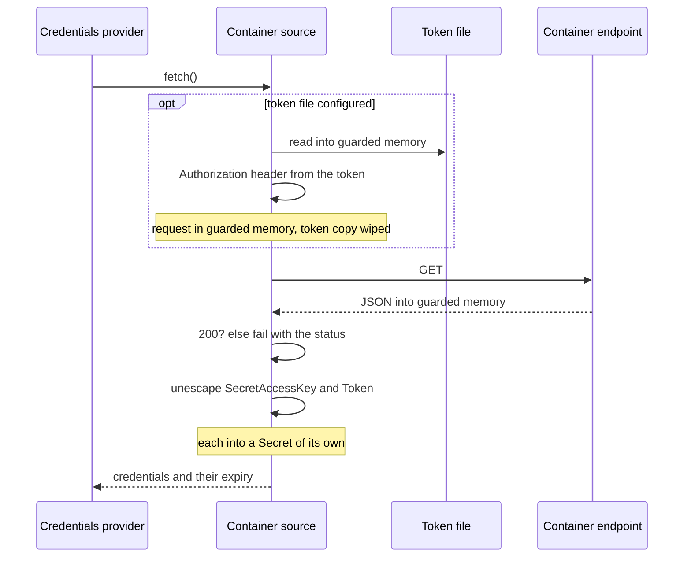

Only `AccessKeyId` and `Expiration` become ordinary Java values. A document that lacks a field, or does not parse, is
a `SecretManagerException` that names the source, with no cause chained. A token with a control character is refused
before the request is sent.

## AWS credentials from EC2 instance metadata

On EC2 the client speaks IMDSv2 only. Every fetch starts with a new session token, which stays in guarded memory and
is sent from there.

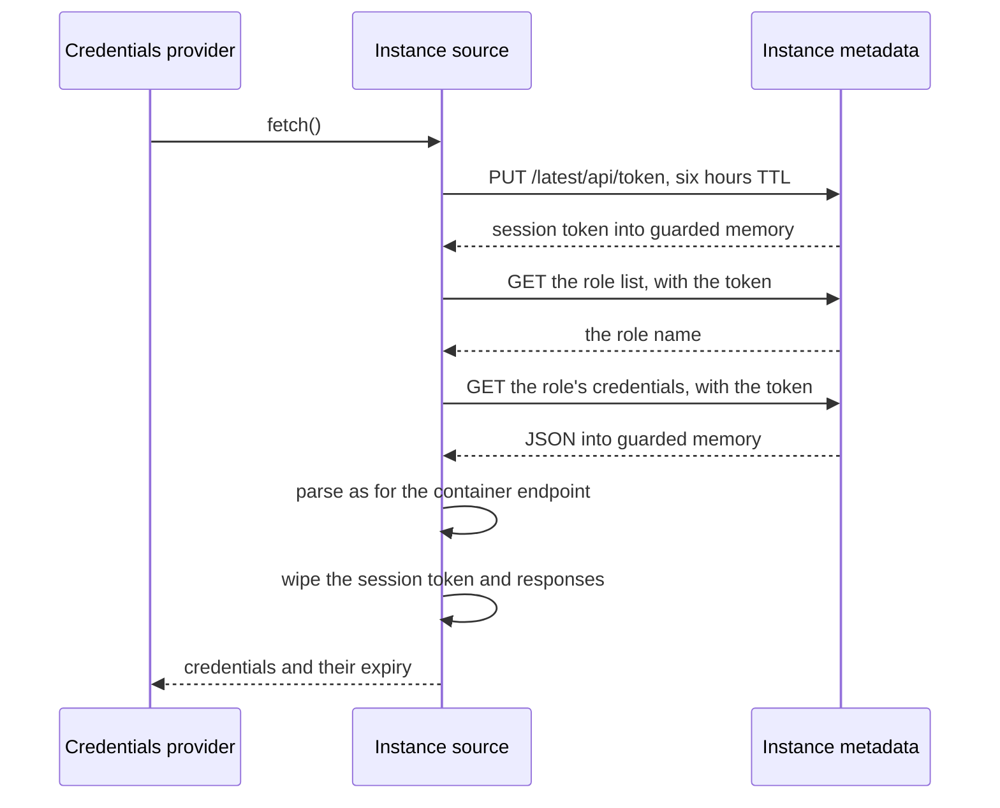

A status other than 200 at any step is a `SecretManagerException` that names the step. A role name that is not a
valid IAM name fails the fetch too. With the shared credentials file, the provider reads and parses the file in
guarded memory instead. That source is described on [the provider page](providers/aws-secrets-manager.md#credentials).
