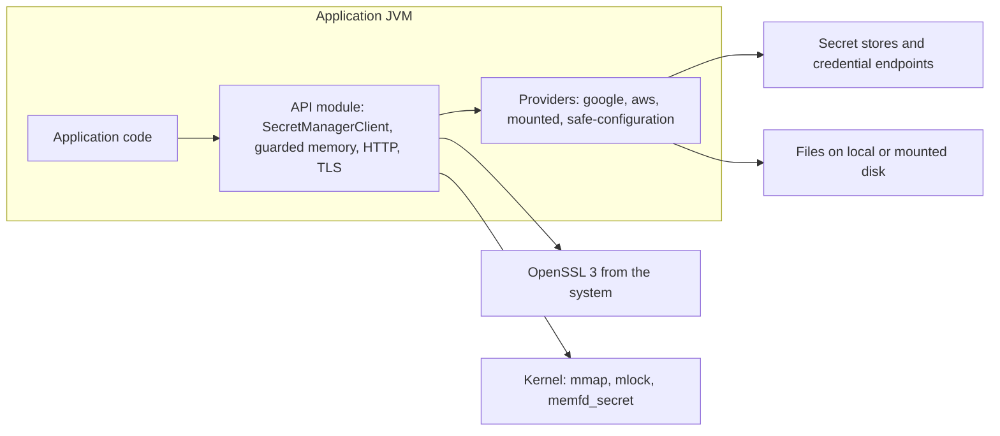
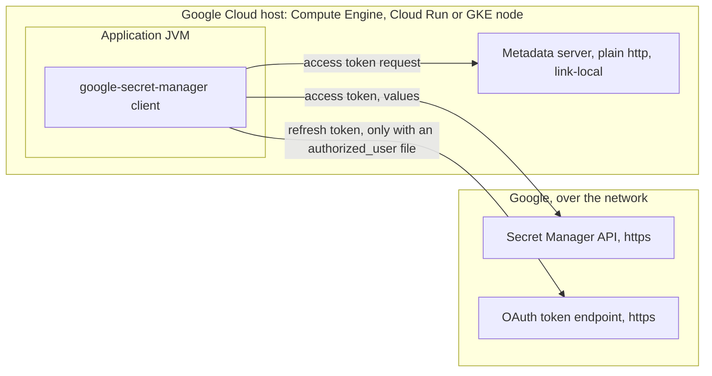
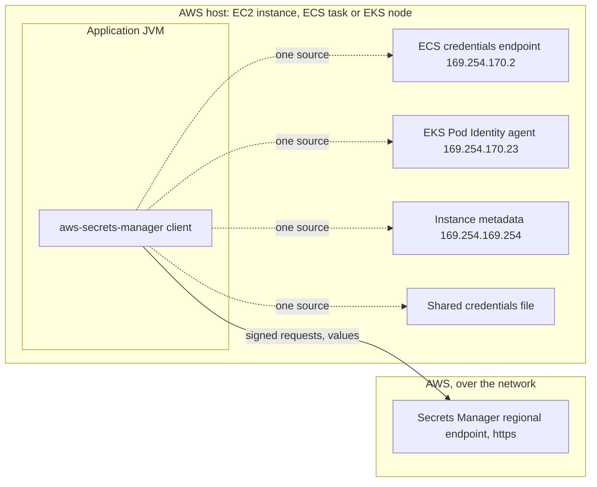
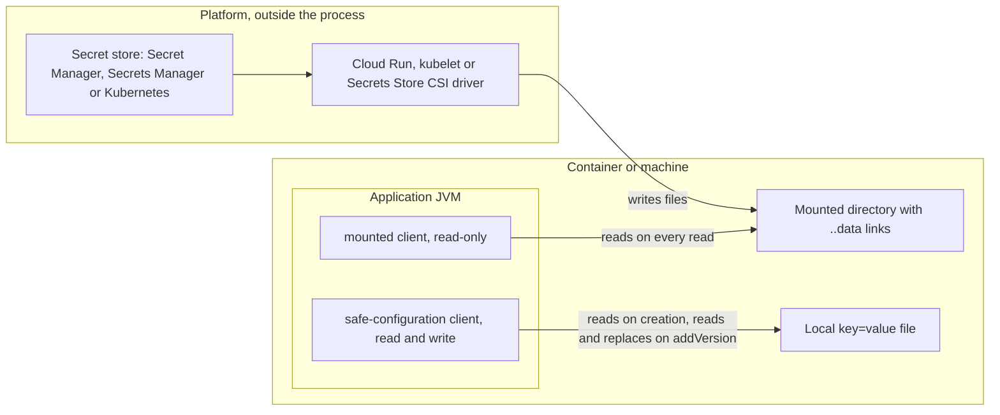

# Topology

Where the secrets client runs, which parties each provider reaches, and what crosses the boundary of the process.
How each provider is configured is on its own page under [providers](README.md); what is protected inside the
process is in the [security model](security.md).

## The application process

Everything the library does happens inside the application's JVM. There is no agent, sidecar or daemon of its own.

- The **API module** (`io.descoped.secrets.api`) holds `SecretManagerClient`, guarded memory, and the HTTP/1.1
  client, JSON reader, codecs, TLS and SHA-256 that the network providers use.
- One or more **providers** are on the module path or the class path. `SecretManagerClient.create` picks one by the
  `secrets.provider` key, so one process can hold clients of several providers at once.
- **OpenSSL 3** is loaded from the system by the Foreign Function & Memory API: `libssl.so.3` and `libcrypto.so.3` on
  Linux, Homebrew's `openssl@3` on macOS. It is not bundled. The AWS provider always needs it, since it signs with
  libcrypto. The Google provider loads it only when it reaches an https endpoint.
- **Guarded memory** is native memory the process maps and locks itself, through system calls to the kernel; see
  [the API](api.md#guarded-memory-secretmemory-and-secret).

The library never listens on a port. Every connection is outbound, opened by the process, one connection per request
(`Connection: close`). Host names are resolved by the JDK's resolver, within the connect timeout. There is no proxy
setting: the process must reach each endpoint directly.

## Google Secret Manager

The `google-secret-manager` provider reaches up to three parties:

- **The Secret Manager API**, `https://secretmanager.googleapis.com` by default, for every `read` and `addVersion`.
  Another host serving the same global API, such as a Private Service Connect endpoint, can be set with
  `secrets.endpoint`.
- **Google's OAuth token endpoint**, `https://oauth2.googleapis.com/token` by default, only with an `authorized_user`
  credentials file. The process sends the refresh token there and gets an access token back.
- **The metadata server**, `http://metadata.google.internal` by default (`169.254.169.254`), only when no credentials
  file is used. On Compute Engine, Cloud Run and GKE with Workload Identity it gives the access token of the attached
  service account, on `GET /computeMetadata/v1/instance/service-accounts/default/token` with
  `Metadata-Flavor: Google`.

In production on Google Cloud the process talks to the metadata server and the Secret Manager API only. On a
developer's machine it talks to the OAuth endpoint and the Secret Manager API, with the developer's own login.

## AWS Secrets Manager

The `aws-secrets-manager` provider reaches the Secrets Manager API and at most one credential source:

- **The Secrets Manager API**, `https://secretsmanager.<region>.amazonaws.com` by default, or
  `amazonaws.com.cn` in the China regions. Each call is a signed `POST` of `GetSecretValue`, `PutSecretValue` or
  `CreateSecret`. A VPC endpoint or a FIPS endpoint is set with `secrets.endpoint`.
- **The ECS container credentials endpoint**, `http://169.254.170.2` plus the path in
  `AWS_CONTAINER_CREDENTIALS_RELATIVE_URI`, for the ECS task role.
- **The EKS Pod Identity agent**, `http://169.254.170.23` or `http://[fd00:ec2::23]`, the URI in
  `AWS_CONTAINER_CREDENTIALS_FULL_URI`. The request carries an authorization token that the process reads from the
  file in `AWS_CONTAINER_AUTHORIZATION_TOKEN_FILE`.
- **EC2 instance metadata (IMDSv2)**, `http://169.254.169.254` or `http://[fd00:ec2::254]`. The process gets a session
  token with `PUT /latest/api/token`, then the instance profile's role and its credentials under
  `/latest/meta-data/iam/security-credentials/`.
- **The shared credentials file**, a local file, with no network call.

Which source is used, and in which order they are tried, is described in
[the provider's credentials section](providers/aws-secrets-manager.md#credentials).

The secret access key and the session token never leave the process. Each request is signed with them in the
process, and only the signature and the session token are sent to Secrets Manager.

## Mounted files and the local file

The `mounted` and `safe-configuration` providers have no network code. They read files.

- **mounted** reads files that the platform writes into a directory: a Cloud Run secret volume, a Kubernetes secret
  volume, or a volume of the Secrets Store CSI driver. The platform, not the process, fetches the secrets from the
  secret store with its own identity. Kubernetes writes each key as a link into a `..data` directory, which it swaps
  on rotation. The provider follows those links as long as they stay inside the directory, and reads the file again
  on every `read`. See [mounted](providers/mounted.md#names-and-files).
- **safe-configuration** reads one local `key=value` file when the client is created. On `addVersion` it reads the
  file again and replaces it atomically by a temporary file in the same directory (that of a symbolic link's target).
  It is for development and tests. See
  [safe-configuration](providers/safe-configuration.md).

## Trust boundaries

### What crosses the network

Every connection that leaves the host carries TLS, through OpenSSL: the Secret Manager API, the OAuth token
endpoint, the Secrets Manager API, and a container credentials endpoint on any host other than the ECS and EKS Pod
Identity addresses. TLS is 1.3 or 1.2, and the server's certificate must chain to a trusted root and match the host.
The trusted roots are the system's, or only those in `secrets.tls.ca-file`. Details are in the TLS sections of the
[Google](providers/google-secret-manager.md#memory-and-tls) and
[AWS](providers/aws-secrets-manager.md#memory-signing-and-tls) providers.

Plain http is accepted only for these hosts:

Endpoint | Hosts accepted over http | Why
---|---|---
Google metadata server | `metadata.google.internal`, `169.254.169.254`, loopback | It is plain http, served on a link-local address by the host the process runs on.
AWS container credentials | `169.254.170.2`, `169.254.170.23`, `fd00:ec2::23`, loopback | It is served by the ECS agent or the EKS Pod Identity agent on the same host, on link-local addresses. Any other host must use https.
AWS instance metadata | `169.254.169.254`, `fd00:ec2::254`, loopback | It is served by the EC2 host, on link-local addresses. It is never accepted over https or on another host.
Secret Manager API, OAuth token endpoint, Secrets Manager API | loopback only | A local test server or emulator. Every other host must use https.

Link-local addresses are not routed beyond the host or the local link, so a request to them does not cross the
network. A loopback address does not leave the machine. An endpoint off these lists is refused when the client is
created, before anything is sent.

### What credentials exist in the process

Provider | Credentials in the process | Held in
---|---|---
google-secret-manager, on Google Cloud | an access token from the metadata server, replaced before it expires | guarded memory
google-secret-manager, on a developer's machine | the client secret and refresh token of an `authorized_user` file, and an access token | guarded memory
aws-secrets-manager, ECS or EKS Pod Identity | temporary keys and a session token; for EKS, also the authorization token, read from its file on each fetch | guarded memory
aws-secrets-manager, EC2 | the IMDSv2 session token, and temporary keys and a session token | guarded memory
aws-secrets-manager, shared credentials file | the keys of one profile | guarded memory
aws-secrets-manager, `secrets.credentials=environment` | keys the JVM already holds in its environment | guarded memory, but the environment keeps them on the heap: outside the guarantee
mounted | none | n/a
safe-configuration | none | n/a

The AWS access key ID, the Google OAuth client ID, the secret names and the endpoints are ordinary Java objects;
they are not secret.
Why some sources are refused is explained in the [security model](security.md#credentials).

## Network requirements

The process needs no inbound port. It needs these outbound connections, and DNS for the host names among them.

Provider and setup | Outbound connections
---|---
google-secret-manager on Google Cloud | `secretmanager.googleapis.com:443`, or the configured endpoint; the metadata server on port 80
google-secret-manager on a developer's machine | `secretmanager.googleapis.com:443`; `oauth2.googleapis.com:443`
aws-secrets-manager on ECS | `secretsmanager.<region>.amazonaws.com:443`, or the configured endpoint; `169.254.170.2:80`
aws-secrets-manager on EKS with Pod Identity | the Secrets Manager endpoint on 443; `169.254.170.23:80` or `[fd00:ec2::23]:80`
aws-secrets-manager on EC2 | the Secrets Manager endpoint on 443; `169.254.169.254:80` or `[fd00:ec2::254]:80`
aws-secrets-manager with a shared credentials file | the Secrets Manager endpoint on 443
mounted | none
safe-configuration | none

A port given in a configured URI replaces the default of 443 for https and 80 for http. On a private network
without internet access, point `secrets.endpoint` at a Private Service Connect endpoint on Google Cloud or at a VPC
endpoint on AWS, so that the API is reached without leaving the network.
